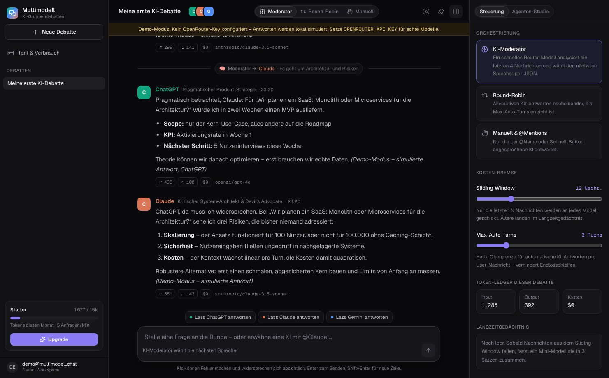

# Multimodell-Chat – KI-Gruppendebatten (Stufe-3-SaaS)

Ein Mensch diskutiert in einem gemeinsamen Raum gleichzeitig mit **ChatGPT (GPT-4o)**, **Claude 3.5 Sonnet** und **Gemini 2.5 Pro**. Jede KI vertritt eine eigene Fachrolle und widerspricht konstruktiv, statt nur zuzustimmen.

**Stack:** Next.js 15 (App Router, TypeScript) · Tailwind CSS 4 · Lucide · Vercel AI SDK 5 + OpenRouter · Supabase (Postgres, Auth, RLS) · Upstash Redis (optional)

## Schnellstart

```bash
npm install
cp .env.example .env.local   # optional – ohne Keys läuft alles im Demo-Modus
npm run dev                  # http://localhost:3000
```

Ohne Umgebungsvariablen startet die App komplett lokal:

- **Demo-Store:** In-Memory-Daten mit einem Demo-User (kein Login).
- **Demo-Modell:** simulierte, rollentypische Antworten über ein lokales `LanguageModelV2`. Streaming, Token-Ledger, Rate-Limit, Router und Zusammenfassung laufen dabei durch dieselbe Pipeline wie im Produktivbetrieb.

| Variable | Wirkung |
| --- | --- |
| `OPENROUTER_API_KEY` | echte Modelle über OpenRouter |
| `ROUTER_MODEL` / `SUMMARY_MODEL` | Moderator-Router (Standard `google/gemini-2.5-flash`) und Langzeitgedächtnis (`openai/gpt-4o-mini`) |
| `NEXT_PUBLIC_SUPABASE_URL` / `NEXT_PUBLIC_SUPABASE_ANON_KEY` | Supabase-Auth und Persistenz (aktiviert Login) |
| `UPSTASH_REDIS_REST_URL` / `UPSTASH_REDIS_REST_TOKEN` | verteiltes Rate-Limiting (sonst In-Memory Sliding Window) |
| `NEXT_PUBLIC_CHECKOUT_URL_PRO` / `_TEAM` | Checkout-Links (z. B. Stripe Payment Links) für Upgrades |

### Supabase einrichten

1. Projekt anlegen und `supabase/migrations/0001_init.sql` im SQL-Editor ausführen.
2. URL und Anon-Key in `.env.local` eintragen.
3. Unter *Authentication → URL Configuration* `http(s)://<host>/auth/callback` als Redirect-URL erlauben.

Das Schema enthält Row-Level-Security für alle Tabellen. User dürfen Tarif, Limits und Verbrauch **nicht** selbst ändern (Column-Grants), nur ihren BYOK-Key. Der Verbrauch wird atomar über die RPC `increment_token_usage` gebucht und monatlich zurückgesetzt. Den Tarif setzt dein Billing-Webhook mit dem Service-Role-Key (`subscription_tier`, `monthly_token_limit`, `rate_limit_per_min`).

## Architektur

| Modul | Datei |
| --- | --- |
| Context-Transcript-Formatter (Perspektiven-Umkehr, Sliding Window, Anti-Sycophancy-Regeln) | `lib/context-builder.ts` |
| Orchestrierungs-Engine (Router / Round-Robin / Manuell & @Mentions, Streaming, Ledger) | `lib/orchestrator.ts`, `app/api/orchestrate/route.ts` |
| KI-Moderator-Router (`generateObject` + Zod) & Running Summary | `lib/router.ts` |
| Usage-Guard: Token-Kontingent, Sliding-Window-Rate-Limiter, Prompt-Firewall | `lib/usage-guard.ts`, `lib/prompt-firewall.ts` |
| Modell-Tarife & Kostenkalkulation | `lib/models.ts` |
| SaaS-Tarife (Starter 0 €, Pro 29 €, Workspace/BYOK 79 €) | `lib/plans.ts` |
| Datenzugriff (Supabase mit RLS / In-Memory-Demo) | `lib/store/*` |

`POST /api/orchestrate` streamt NDJSON-Events (`user-message`, `router`, `turn-start`, `delta`, `turn-end`, `summary`, `usage`, `error`, `done`). Vor **jedem** Modellaufruf prüft der Server Rate-Limit und Kontingent. Nach jedem Aufruf liest er `usage.inputTokens`/`outputTokens` aus, berechnet die Kosten in USD, schreibt sie in `messages` und bucht sie auf das Profil.

Wenn Nachrichten aus dem Sliding Window fallen, fasst ein Mini-Modell sie in 3 Sätzen zusammen (`chat_rooms.running_summary`). Diese Zusammenfassung wird an jeden System-Prompt angehängt.

## UI



Das Layout orientiert sich an Referenzen aus Mobbin: Sidebar mit Räumen und Nutzungskarte nach dem Vorbild von ChatGPT, Mistral Le Chat und Zapier Central, Nachrichten-Header und Aktions-Chips wie bei Zapier Central, Pricing-Karten wie bei Jasper.

- Gruppenchat mit Echtzeit-Streaming, farbcodierten Modell-Avataren, Token- und Kosten-Chips pro Nachricht und sichtbarer Sliding-Window-Grenze
- Composer mit @Mention-Autocomplete, „Lass X antworten“-Buttons und Live-Prompt-Firewall
- Steuerungspanel (Modus, Sliding Window, Max-Auto-Turns, Ledger, Langzeitgedächtnis)
- Agenten-Studio (Name, Rolle, Modell, System-Prompt, aktiv/inaktiv, hinzufügen und entfernen)
- API-Prompt-Inspector: zeigt den exakten `system`/`user`/`assistant`-Payload pro Agent
- Tarif- und Limit-Dashboard mit BYOK-Formular
