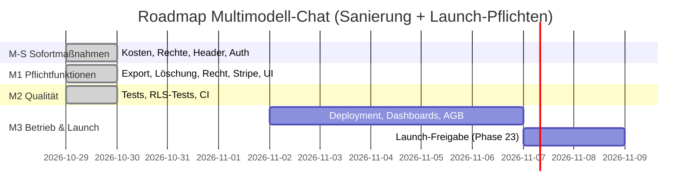

# Roadmap

## Aufgaben

| ID | Meilenstein | Titel | Bezug | Akzeptanzkriterien | Sicherheit | Abhängig von | Größe | Status |
|---|---|---|---|---|---|---|---|---|
| TASK-001 | M-S | Konfiguration „fail closed“, Demo nie mit Plattform-Key in Produktion | BF-01, F-14, T-SEC-01 | Produktion ohne Pflichtvariablen → 503; Demo nur lokal/ausdrücklich | Regel 1.1, 10.4 | – | S | erledigt |
| TASK-002 | M-S | Verbrauch bei Abbruch/Fehler buchen, Teilantwort speichern | BF-04, F-03, F-07, T-SEC-02 | AK-F03-1, AK-F07-1 | Regel 4.5 | – | M | erledigt |
| TASK-003 | M-S | Kostenbremsen: Vorab-Schätzung, Kontext-Budget, Modell-Allowlist, Tarifgrenzen serverseitig, Summary begrenzen | BF-02, BF-03, BF-05, BF-21, BF-28, BF-29, F-02, F-04, F-05, F-06, F-07, F-10, T-SEC-03, T-SEC-05, T-SEC-08, T-SEC-09 | AK-F02-1, AK-F02-2, AK-F04-1 … AK-F04-3, AK-F05-1 … AK-F05-3, AK-F06-1, AK-F06-2, AK-F10-1, AK-F10-2 | Regeln 4.5, 8.4 | TASK-002 | M | erledigt |
| TASK-004 | M-S | DB-Härtung (Migration 0002): Grants, Längen-CHECKs, Service-Role-Schreibpfad, Summen-View; BYOK verschlüsselt | BF-08, BF-12, BF-22, BF-24, F-07, F-13, T-SEC-04, T-SEC-10, T-SEC-16, T-SEC-17, T-SEC-18, T-SEC-19, T-SEC-20, T-SEC-21, T-SEC-22 | AK-F13-1, AK-F13-2 | Regeln 2.1–2.7, 1.1 | – | M | erledigt |
| TASK-005 | M-S | Rate-Limits pro Konto und IP, 429 + Retry-After vor dem Stream, Rundensperre, Upstash Pflicht | BF-06, BF-18, BF-25, F-08, T-SEC-06, T-SEC-07 | AK-F08-1 | Regeln 4.1, 4.3 | – | M | erledigt |
| TASK-006 | M-S | CSP mit Nonce, Security-Header, Origin-Prüfung, Body-Limit, Markdown ohne externe Bilder | BF-07, BF-31, T-SEC-11, T-SEC-12, T-SEC-15, T-SEC-28 | Header auf jeder Antwort; keine Konsolenfehler | Regeln 5.3, 5.4, 6.2 | – | M | erledigt |
| TASK-007 | M-S | Fehler allgemein mit Referenz, 404-Strategie, sichere Logs, Sicherheitslog, Fehlerseite | BF-10, BF-11, BF-23, BF-30, BF-32, T-SEC-13, T-SEC-14, T-SEC-29 | keine internen Texte in Antworten | Regeln 2.4, 7.2, 9.3, 9.4 | – | S | erledigt |
| TASK-008 | M-S | Auth serverseitig, Cookies HttpOnly/Secure/SameSite, 30 Tage | BF-26, F-01, T-SEC-26 | AK-F01-2 | Regel 3.6 | – | M | erledigt |
| TASK-009 | M-S | Login-/Reset-Abläufe: einheitliche Antworten, Fehlversuchs-Sperre, Passwort 15, Reset + neue Sitzung | BF-13, F-01, F-17, T-SEC-23, T-SEC-24 | AK-F01-1, AK-F01-3, AK-F01-4, AK-F17-1, AK-F17-2 | Regeln 3.3–3.5, 4.1, 4.2 | TASK-008 | M | erledigt |
| TASK-010 | M1 | Datenexport und Konto löschen mit erneuter Anmeldung | BF-16, F-15, F-16, T-SEC-22 | AK-F15-1, AK-F16-1 | Regeln 7.3, 7.4 | TASK-004, TASK-008 | M | erledigt |
| TASK-011 | M1 | Impressum, Datenschutzerklärung, KI-Hinweis, `data_collection: deny` | BF-16, BF-17, F-18 | AK-F18-1, AK-F18-2 | Regel 8.4 | – | S | erledigt |
| TASK-012 | M1 | Stripe: Checkout mit Nutzer-ID, Webhook (Signatur, Idempotenz), Portal, Migration 0003 | BF-27, F-12, T-SEC-25, T-SEC-27 | AK-F12-1 … AK-F12-3 | Regeln 8.1, 8.2 | TASK-004 | M | erledigt |
| TASK-013 | M1 | Responsive Schubladen, Tastaturbedienung, Fokus im Dialog | BF-14 | Alle Funktionen bei 390 px erreichbar (Smoke-Test) | – | – | M | erledigt |
| TASK-014 | M1 | Demo-Workspace nur lokal mit simuliertem Modell | F-14, BF-01 | siehe TASK-001 | Regel 10.4 | TASK-001 | S | erledigt |
| TASK-015 | M2 | Tests: Unit, Integration, Routen, Middleware, Auth, Webhook, RLS + Gegenprobe | BF-09 | `npm test`, `npm run test:rls` grün | Regeln 10.1, 10.2 | TASK-001 … TASK-012 | M | erledigt |
| TASK-016 | M2 | CI (Typecheck, Tests, Build, Audit, RLS, gitleaks), Dependabot | BF-09, BF-15 | Workflow grün auf GitHub | Regel 9.6 | TASK-015 | S | erledigt (erster Lauf auf GitHub ausstehend) |
| TASK-017 | M2 | zod 4.6.7; Restbefunde bewerten | BF-15 | `npm audit --audit-level=critical` grün | Regel 9.2 | – | S | erledigt (E-005) |
| TASK-024 | M2 | Nachsanierung nach Zweitprüfung 14: Passwortänderung/Reauth an Sitzung gebunden, Abbruch-Reservierung, Webhook live + Abo-Abgleich, kein Zweit-Checkout, Löschung nur nach Kündigung, Demo je Besucher, Migration 0004 (Spalten-Grants Agenten, harte Obergrenzen), Lock-Token, Client-IP, Profil-Allowlist, APP_ORIGIN Pflicht | T-SEC-30, T-SEC-31, T-SEC-32, T-SEC-33, T-SEC-34 | alle Tests grün | Regeln 3.5, 3.6, 4.1, 8.2 | TASK-015 | M | erledigt |
| TASK-018 | M3 | Deployment Vercel + Supabase Pro + Upstash; Backups/Wiederherstellungstest; Monitoring/Alarme; Incident-Plan; `billing_events` nach 90 Tagen löschen | BF-20 | `20-betrieb.md` umgesetzt, Wiederherstellung einmal geübt | Regel 9.7 | – | M | offen |
| TASK-019 | M3 | AGB und Widerrufsbelehrung (Fachperson), Seite `/agb`, Link bei Checkout | – | Texte geprüft, verlinkt | – | – | S | offen (braucht Rechtstext) |
| TASK-020 | M3 | Barrierefreiheit: Browser-Prüfung (Namen, Kontrast, Fokus, Überlauf) in drei Farbwelten × zwei Breiten | BF-14 | `node scripts/a11y-check.cjs` → A11Y-CHECK PASSED | – | TASK-013 | S | erledigt (`scripts/a11y-check.cjs`; Lighthouse/Screenreader-Test von Hand vor Launch) |
| TASK-021 | M3 | Supabase-Dashboard: Confirm email, Mindestlänge 15, Leaked-Password-Schutz, OTP 1800 s, Time-box 90 Tage, Refresh-Rotation, Redirect-Allowlist, Region EU | F-01, F-17 | Einstellungen dokumentiert (Screenshot) | Regeln 3.3–3.6 | TASK-018 | S | offen |
| TASK-022 | M3 | OpenRouter: Credit-Limit + Alarm, Kontoeinstellung „data collection deny“, Verfügbarkeit der Katalogmodelle mit `deny` prüfen, Preise in `lib/models.ts` aktualisieren | F-07 | jedes Katalogmodell antwortet mit `deny` | Regel 4.5 | TASK-018 | S | offen |
| TASK-023 | M3 | Launch-Freigabe (Phase 23) mit Nachweisen; Betreiberangaben setzen | – | Prüfskript `--launch` freigabefähig | alle | TASK-018 … TASK-022 | S | offen |
