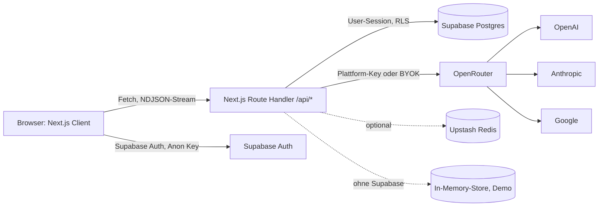
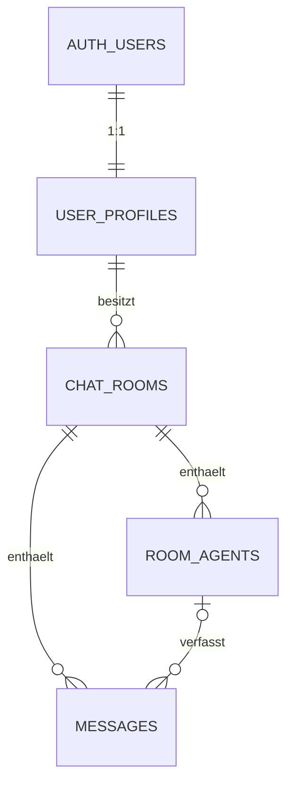

# Ist-Analyse: Multimodell-Chat

> Erstellt im Modus „Bestehende App“ (B1). Nur lesend erstellt, am Code wurde nichts verändert.
> Analysierter Stand: Branch `ccr-aab1b190-y70xl3`, Commit `022f44c` · Datum 2026-10-29
> Unabhängige Zweitprüfung: `pruefungen/zweitpruefung-b1-2026-10-29.md` (erstellt parallel zu dieser Analyse). Nach dem Abgleich wurden ihre Befunde eingearbeitet: neue Befunde BF-24 bis BF-32, Neubewertung von BF-04, BF-12 und BF-15. Die Zuordnung ZP → BF steht in der Spalte „Bezug“.

## Zusammenfassung

- **Gesamteindruck:** Die Kernfunktionen (Gruppenchat, drei Orchestrierungsmodi, Streaming, Token-Ledger, Agenten-Studio) sind vollständig und im Demo-Modus nachweislich lauffähig. Für eine Veröffentlichung reicht der Stand nicht: Schutzmaßnahmen gegen Kostenmissbrauch sind umgehbar, die Konfiguration „fällt offen“ (fehlende Supabase-Variablen ergeben eine App ohne Login), Security-Header fehlen, es gibt keine Tests und keine CI, und Pflichtfunktionen des Datenschutzes (Konto löschen, Export, Rechtstexte) fehlen.
- **Befunde:** kritisch 3 · hoch 9 · mittel 14 · niedrig 6 (nach Einarbeitung der Zweitprüfung)
- **Risikostufe:** 2. Nutzerkonten mit E-Mail und eigenen Chat-Inhalten, Bezahlung nur über einen externen Zahlungsanbieter. Chat-Inhalte gehen an KI-Anbieter (OpenRouter und dahinter OpenAI/Anthropic/Google). Freitexte *können* besondere Daten enthalten. Das wird in Phase 11 bewertet (E-002).
- **Nicht prüfbar:** Supabase-Dashboard-Einstellungen (Passwortregeln, Leaked-Password-Schutz, E-Mail-Bestätigung, Auth-Rate-Limits, Backups/PITR), Hosting-Konfiguration (es existiert noch kein Deployment), OpenRouter-Kontoeinstellungen (Budgetgrenze, Datenrichtlinie).

## 1. Überblick

| Punkt | Ist |
|---|---|
| Sprache / Framework | TypeScript 5, Next.js 15.5 (App Router), React 19.1, Tailwind CSS 4 |
| Wichtige Abhängigkeiten (Version) | `ai` 5.0.282, `@openrouter/ai-sdk-provider` 1.5.4, `@supabase/ssr` 0.12.7, `@supabase/supabase-js` 2.118, `@upstash/ratelimit` 2.2, `zod` 3.25.76 (laut Lockfile), `react-markdown` 10 |
| Start / Build / Test | `npm run dev`, `npm run build`, `npm run typecheck`; **kein Testskript** |
| Hosting / Deployment | nicht konfiguriert (kein `vercel.json`, kein Dockerfile); Zielplattform laut Masterprompt Vercel [ANNAHME A-003] |
| CI | keine (`.github/` fehlt) |

## 2. Funktionen & Screens

| ID | Funktion | Status | Fundstelle |
|---|---|---|---|
| F-01 | Registrierung, Anmeldung, Abmeldung (E-Mail + Passwort über Supabase) | fertig, ohne Passwort-Reset | `app/login/LoginForm.tsx`, `lib/supabase/middleware.ts` |
| F-02 | Debatten-Räume anlegen, umbenennen, löschen, Liste | fertig | `app/api/rooms/**`, `components/shell/Sidebar.tsx` |
| F-03 | Gruppenchat mit Streaming mehrerer KI-Agenten | fertig | `app/api/orchestrate/route.ts`, `lib/orchestrator.ts` |
| F-04 | Orchestrierungsmodi Router / Round-Robin / Manuell inkl. @Mentions und Schnell-Buttons | fertig | `lib/router.ts`, `components/chat/Composer.tsx` |
| F-05 | Kontext-Formatter mit Perspektiven-Umkehr und Sliding Window | fertig | `lib/context-builder.ts` |
| F-06 | Langzeitgedächtnis (Running Summary) | fertig | `lib/router.ts:122`, `lib/orchestrator.ts` |
| F-07 | Token-Ledger, Kostenschätzung pro Nachricht, Monatskontingent | fertig, umgehbar (BF-03, BF-04, BF-05) | `lib/orchestrator.ts`, `lib/models.ts` |
| F-08 | Rate-Limit pro Minute je Tarif | halb fertig (nur pro Konto, nicht instanzübergreifend ohne Upstash) | `lib/usage-guard.ts:50` |
| F-09 | Prompt-Firewall (Muster-Erkennung) | fertig (Regex, leicht umgehbar) | `lib/prompt-firewall.ts` |
| F-10 | Agenten-Studio (Rollen, Modell, System-Prompt, aktiv/inaktiv, hinzufügen/entfernen) | fertig | `components/chat/AgentStudio.tsx`, `app/api/agents/**` |
| F-11 | API-Prompt-Inspector | fertig | `components/chat/PromptInspector.tsx` |
| F-12 | Tarif- und Verbrauchs-Dashboard, Tarifwechsel | halb fertig (Checkout-Link, kein Webhook) | `app/billing/page.tsx`, `app/api/billing/plan/route.ts` |
| F-13 | Bring Your Own Key (OpenRouter) | fertig, Key im Klartext gespeichert | `app/api/profile/route.ts` |
| F-14 | Demo-Modus (In-Memory-Store, simuliertes Modell) | fertig, fällt offen (BF-01) | `lib/session.ts:25`, `lib/ai/demo-model.ts` |

| ID | Screen / Route | Zweck | Fundstelle |
|---|---|---|---|
| S01 | `/login` | Anmelden / Registrieren | `app/login/` |
| S02 | `/chat` | Weiterleitung auf neueste Debatte | `app/chat/page.tsx` |
| S03 | `/chat/[roomId]` | Gruppenchat mit Seitenpanel (Steuerung, Agenten-Studio) | `components/chat/ChatWorkspace.tsx` |
| S04 | `/billing` | Tarif, Verbrauch, BYOK | `components/billing/BillingDashboard.tsx` |
| S05 | Modal „API-Prompt Inspector“ | Payload-Ansicht | `components/chat/PromptInspector.tsx` |

Zustände: Leerzustand (Starter-Prompts), Ladezustand (Streaming-Cursor, „denkt nach…“) und Fehlerbanner sind vorhanden. Es fehlt eine responsive Ansicht: Seitenleiste fest 264 px, Seitenpanel erst ab `xl`, Modus-Umschalter erst ab `lg` (BF-14).

## 3. Daten

| Objekt.Feld | Klasse | Bemerkung |
|---|---|---|
| auth.users.email | personenbezogen | bei Supabase Auth |
| user_profiles.custom_openrouter_key | geheim | **Klartext** in der Datenbank (BF-08) |
| user_profiles.tokens_used_this_month, subscription_tier | personenbezogen (Vertragsdaten) | per Column-Grant vor Nutzeränderung geschützt |
| messages.content | personenbezogen, potenziell sensibel (Freitext) | geht an KI-Anbieter |
| room_agents.system_prompt | Nutzerinhalt | geht an KI-Anbieter |
| chat_rooms.running_summary | abgeleiteter Nutzerinhalt | geht an KI-Anbieter |

Externe Dienste und Datenflüsse: OpenRouter erhält Chat-Verlauf (Sliding Window), System-Prompts und die Zusammenfassung und reicht sie an die Modellanbieter weiter. Dabei wird keine Datenrichtlinie gesetzt (`data_collection` nicht auf `deny`, BF-17). Supabase speichert alle Daten. Upstash speichert nur Nutzer-IDs als Rate-Limit-Schlüssel. Uploads gibt es nicht.

## 4. Sicherheit

| Prüfpunkt | Ist | Bewertung | Befund |
|---|---|---|---|
| Secrets im Code / Client-Variablen | Keine Schlüssel im Repo; nur `NEXT_PUBLIC_SUPABASE_*` (öffentlich) | ✅ | – |
| Zugriffskontrolle / Besitzprüfung | Räume über `getRoom` + RLS; Agent-Routen verlassen sich allein auf RLS und liefern bei fremder ID 500 statt 404 | ⚠️ | BF-11 |
| Datenbankregeln (RLS / Rules) | RLS auf allen 4 Tabellen, Column-Grant für Profil; Wirksamkeit nicht getestet; Dashboard-Status nicht prüfbar | ⚠️ / ❓ | BF-09, BF-12 |
| Mass Assignment | Zod-Allowlists in den API-Routen; über die öffentliche Supabase-REST-API können Clients aber alle Spalten von `chat_rooms`, `room_agents`, `messages` und den BYOK-Key schreiben – die Routen-Validierung ist damit umgehbar | ❌ | BF-12, BF-24 |
| Login / Passwort / Reset | Supabase Auth; Mindestlänge im Client 8 (Standard: 12/15); kein Reset-Ablauf; Sitzungs-Cookies nicht `HttpOnly`, 400 Tage (Default von `@supabase/ssr`) | ❌ | BF-13, BF-26 |
| Rate Limiting | Nur pro Konto, nicht pro IP; ohne Upstash pro Server-Instanz; kein `Retry-After`; nur Modellaufrufe begrenzt | ❌ | BF-06 |
| Eingabevalidierung / XSS / SQL | Zod auf allen Routen (aber über REST-API umgehbar, BF-12); keine Längen-Constraints in der DB; `react-markdown` ohne Roh-HTML, externe Bilder erlaubt; Supabase-Query-Builder | ⚠️ | BF-12, BF-31 |
| Header / CORS / HTTPS | Keine Security-Header, keine CSP; keine Origin-Prüfung bei Cookie-Sitzung | ❌ | BF-07 |
| Abhängigkeiten | Lockfile vorhanden; `npm audit`: zod < 4.6.6 (hoch), postcss in Next (hoch, Build-Zeit), `@fastify/busboy` über undici (hoch) | ❌ | BF-15 |
| Logging sensibler Daten | `console.error` mit Fehlerobjekten; 500-Antworten reichen interne Fehlermeldungen (z. B. Datenbankfehler) an den Client durch | ⚠️ | BF-10 |

## 5. Qualität & Betrieb

| Punkt | Ist | Befund |
|---|---|---|
| Tests | keine | BF-09 |
| Fehlerbehandlung | Fehlerbanner im Client; abgebrochene oder fehlgeschlagene Turns werden nicht verbucht | BF-04 |
| Monitoring / Backups | keins / nicht prüfbar (Supabase-Plan) | BF-20 |
| Struktur (nur wo sie Änderungen behindert) | übersichtlich; Demo- und Produktivpfad sauber getrennt über `DataStore` | – |

## 6. Recht (soweit im Code erkennbar)

| Punkt | Vorhanden? | Befund |
|---|---|---|
| Impressum / Datenschutzerklärung | nein | BF-16 |
| Einwilligung Tracking | kein Tracking vorhanden – nicht nötig | – |
| Konto-Löschung / Datenexport | nein | BF-16 |
| KI-Transparenz (Hinweis, Anbieter, Datenweitergabe) | nur Hinweis „KIs können Fehler machen“ | BF-17 |

## Befunde

| ID | Schweregrad | Bereich | Fundstelle | Beschreibung | Sicherheit der Aussage | Empfehlung |
|---|---|---|---|---|---|---|
| BF-01 | kritisch | Sicherheit | `lib/session.ts:25`, `app/api/billing/plan/route.ts:21` | Fehlen die Supabase-Variablen in Produktion, läuft die App ohne Login mit einem gemeinsamen In-Memory-Konto für alle Besucher. Ist `OPENROUTER_API_KEY` gesetzt, kann jeder Besucher den Plattform-Key nutzen und sich per Tarifwechsel kostenlos 2,5 Mio. Tokens freischalten (Konfiguration „fällt offen“). | sicher | In Produktion ohne Supabase nicht starten (fail closed); Demo-Store nie mit echtem Plattform-Key; Tarifwechsel im Demo-Store nur in Entwicklung |
| BF-02 | hoch | Kosten | `lib/validation.ts:19`, `lib/orchestrator.ts:125` | Nutzer können im Agenten-Studio jede beliebige OpenRouter-Modell-ID eintragen. Das Kontingent zählt Tokens, nicht Kosten, also kosten teure Modelle mit dem Plattform-Key ein Vielfaches. | sicher | Mit dem Plattform-Key nur freigegebene Modelle (Allowlist); beliebige Modelle nur mit BYOK |
| BF-03 | hoch | Kosten | `lib/usage-guard.ts:81`, `lib/validation.ts:7,22,37` | Die Kontingentprüfung verlangt nur „> 0 Tokens übrig“. Ein Aufruf mit großem Kontext (Window bis 100 × 8.000 Zeichen + System-Prompt 8.000) kann das Kontingent um ein Vielfaches überziehen. Parallele Anfragen bestehen die Prüfung gleichzeitig. | sicher | Input-Tokens vorab schätzen und gegen den Rest prüfen; Kontext hart begrenzen; Window-Maximum mit der UI angleichen; parallele Runden pro Nutzer begrenzen |
| BF-04 | kritisch | Kosten | `lib/orchestrator.ts:160–189` | Bricht der Client den Stream ab oder schlägt das Modell fehl, wird der Verbrauch nicht gebucht. Durch Abbrechen kurz vor Ende lässt sich das Kontingent dauerhaft umgehen. | sicher | Verbrauch auch bei Abbruch/Fehler buchen (gemeldete Usage, sonst Schätzung aus Prompt + gestreamtem Text) |
| BF-05 | mittel | Kosten | `lib/orchestrator.ts:197–212` | Die Zusammenfassung läuft nach jeder Runde, wenn genug Nachrichten herausgefallen sind; bei Fehler im Summary-Aufruf wird die ganze Runde als Fehler gemeldet, obwohl die Antworten gespeichert sind. | sicher | Summary-Fehler abfangen und nur protokollieren |
| BF-06 | hoch | Sicherheit | `lib/usage-guard.ts:21–58`, `app/api/orchestrate/route.ts` | Rate-Limit nur pro Konto, nicht pro IP. Ohne Upstash pro Server-Instanz (auf Vercel praktisch wirkungslos). Keine HTTP-429-Antwort mit `Retry-After`. Übrige API-Routen ohne Limit. | sicher | Limit pro Konto **und** IP, vor dem Stream als HTTP 429 + `Retry-After`; in Produktion Upstash verpflichtend; allgemeines API-Limit |
| BF-07 | hoch | Sicherheit | `next.config.ts`, `middleware.ts` | Keine Security-Header (CSP, HSTS, nosniff, Referrer-Policy, Permissions-Policy, frame-ancestors). Keine Origin-Prüfung für schreibende API-Aufrufe (CSRF-Schutz nur implizit über `SameSite=Lax`). Keine Begrenzung der Anfragegröße. | sicher | Header + nonce-basierte CSP in der Middleware; Origin-Prüfung; Body-Limit |
| BF-08 | mittel | Sicherheit | `supabase/migrations/0001_init.sql:12` | Der BYOK-Key liegt im Klartext in der Datenbank. Ein Datenbank-Leck oder Backup-Zugriff gibt fremde OpenRouter-Keys preis. | sicher | Mit serverseitigem Schlüssel verschlüsseln (AES-256-GCM aus Node `crypto`), im Client nur Hinweis anzeigen |
| BF-09 | hoch | Qualität | Repository | Keine automatisierten Tests, keine CI; RLS-Regeln nie gegen eine Datenbank geprüft (Regel 10.1/10.2). | sicher | Unit-, Integrations- und RLS-Tests; GitHub-Actions-Workflow |
| BF-10 | mittel | Sicherheit | `lib/api.ts:18`, `lib/orchestrator.ts:104` | Bei 500 und im Stream-Fehlerevent wird `error.message` an den Client gegeben (z. B. Datenbank- oder Anbieterfehler). | sicher | Allgemeine Meldung an den Client, Details nur ins Server-Log |
| BF-11 | mittel | Sicherheit | `app/api/agents/[agentId]/route.ts` | Fremde oder ungültige Agent-IDs ergeben 500 mit Datenbankfehlermeldung statt 404 (Zugriffs-Antwortstrategie); keine UUID-Prüfung der Pfadparameter. | sicher | Parameter validieren, Besitz über RLS-Abfrage prüfen, 404 bei „nicht gefunden“ |
| BF-12 | hoch | Daten / Kosten | `supabase/migrations/0001_init.sql:74–83` | Die `FOR ALL`-Policies erlauben über die REST-API das Schreiben aller Spalten: beliebig lange Nachrichten und `running_summary` (gehen bei jedem Turn in den Prompt → Kosten), gefälschte Ledger-Einträge, Modell-IDs ohne Prüfung, mehr Agenten als der Tarif erlaubt. (Korrigiert nach ZP-03: Die Abrechnung **ist** betroffen.) | sicher | Clients nur `SELECT`/`DELETE` auf Ledger und Gedächtnis; Schreiben nur serverseitig mit Service-Role; Längen-CHECKs; Tarifgrenzen beim Modellaufruf erneut prüfen |
| BF-13 | mittel | Sicherheit | `app/login/LoginForm.tsx:70` | Kein Passwort-Reset; Mindestlänge 8 statt Projektstandard; Supabase-Passwortregeln nicht prüfbar. | sicher | Reset-Ablauf mit identischer Antwort; Mindestlänge im Client und im Supabase-Dashboard angleichen |
| BF-14 | mittel | UX | `components/shell/Sidebar.tsx:55`, `components/chat/ChatWorkspace.tsx:298,362`, `MessageItem.tsx:71`, `Sidebar.tsx:106` | Unter 1280 px ist das Seitenpanel (Steuerung, Agenten-Studio) nicht erreichbar, auf Mobilgeräten ist die App unbenutzbar. Löschen- und Inspector-Buttons erscheinen nur bei Mausover (nicht per Tastatur sichtbar). | sicher | Responsive Schubladen (Drawer) für Seitenleiste und Panel; Aktionen bei Fokus sichtbar |
| BF-15 | hoch | Sicherheit | `package.json`, `package-lock.json` | `npm audit` (2026-10-29): zod 3.25.76 (hoch, Speichererschöpfung bei großen Collections), postcss < 8.5.23 in Next 15 (hoch, nur Build-Zeit), `undici`/`@fastify/busboy` über `@ai-sdk/provider-utils` (hoch, nur Multipart-Parsing), dazu 4 mittlere. (Korrigiert nach ZP-21: Version laut Lockfile 3.25.76.) | sicher | zod auf 4.6.7 heben; übrige bewerten und als Risiko dokumentieren, bis Upstream-Fix verfügbar; Dependabot |
| BF-16 | hoch | Recht | Repository | Kein Impressum, keine Datenschutzerklärung, keine Konto-Löschung, kein Datenexport (DSGVO Art. 13, 17, 20; § 5 DDG) [Q-001] [Q-002] | sicher | Seiten `/impressum`, `/datenschutz` mit Betreiberdaten aus der Konfiguration; „Konto löschen“ und „Daten exportieren“ |
| BF-17 | mittel | Recht | `lib/ai/provider.ts` | Nutzer werden nicht informiert, welche Daten an welche KI-Anbieter gehen; OpenRouter-Datenrichtlinie nicht gesetzt (Anbieter mit Datennutzung zum Training möglich) [Q-003] | wahrscheinlich | `provider.data_collection = "deny"` setzen; Hinweis im Chat und in der Datenschutzerklärung |
| BF-18 | niedrig | Qualität | `lib/usage-guard.ts:19` | In-Memory-Zeitfenster-Map wächst ohne Aufräumen. | sicher | Periodisch leere Einträge entfernen |
| BF-19 | niedrig | UX | `components/chat/ChatWorkspace.tsx` | Moderator-Hinweise (Router-Begründungen) sind flüchtig und nach Neuladen weg. | sicher | Später: als `system`-Nachricht speichern (Parkplatz) |
| BF-20 | mittel | Betrieb | Repository | Kein Deployment-, Monitoring-, Backup- oder Notfallkonzept. | sicher | Phase 20 |
| BF-21 | niedrig | Qualität | `lib/orchestrator.ts` | Zwei gleichzeitige Runden im selben Raum laufen verschränkt. | sicher | Mit Begrenzung paralleler Runden pro Nutzer (BF-03) mit abgedeckt |
| BF-22 | niedrig | Qualität | `app/billing/page.tsx` | Das Dashboard lädt für die Ledger-Summe alle Nachrichten aller Räume (N+1-Abfragen, wächst unbegrenzt). | sicher | Aggregation in der Datenbank (View/RPC) |
| BF-23 | mittel | Sicherheit | `lib/supabase/middleware.ts` | Fehlt das Profil (z. B. Trigger nicht angelegt), schlagen alle Seiten mit 500 fehl; keine verständliche Fehlerseite. | wahrscheinlich | Fehlerseite (`app/error.tsx`) mit allgemeiner Meldung |

| BF-24 | kritisch | Kosten | `0001_init.sql:72`, `lib/usage-guard.ts:72`, `lib/ai/provider.ts:6` | Ein BYOK-Key aus Leerzeichen (direkt per REST-API gesetzt) gilt bei der Kontingentprüfung als „eigener Key“, wird beim Aufruf aber zu leer getrimmt, sodass der Plattform-Key bezahlt. Das Kontingent ist damit in jedem Tarif aufgehoben. (ZP-01) | sicher | Eine gemeinsame Funktion für „hat Key“ und „welcher Key“; Spalte für Clients nicht schreib- und lesbar; Format-CHECK in der DB; BYOK nur im Team-Tarif |
| BF-25 | hoch | Kosten / UX | `lib/orchestrator.ts:63–75,123,207` | Router- und Summary-Aufrufe zählen gegen dasselbe Minutenlimit wie Agenten-Antworten. Im Gratis-Tarif (5/min) scheitert damit schon die erste Nachricht im Standardraum. (ZP-08) | sicher | Minutenlimit zählt Agenten-Antworten; Router/Summary laufen über Rundenlimit und Kontingent |
| BF-26 | mittel | Sicherheit | `lib/supabase/server.ts`, `lib/supabase/middleware.ts` | Sitzungs-Cookies nicht `HttpOnly`, `maxAge` 400 Tage, `Secure` nicht explizit (Defaults von `@supabase/ssr` 0.12.7). (ZP-15) | sicher | Auth-Abläufe serverseitig abwickeln, Cookies `HttpOnly`, `Secure`, `SameSite=Lax`, Laufzeit nach Projektwert |
| BF-27 | mittel | Recht / Zahlung | `app/api/billing/plan/route.ts:24–26` | Kein Webhook, keine Zuordnung des Checkouts zum Nutzer: Ein bezahltes Upgrade kommt nie an; beim Downgrade bleibt der BYOK-Key bestehen. (ZP-12) | sicher | Webhook mit Signaturprüfung, Zeitstempel und Idempotenz; Checkout mit Nutzer-ID; Downgrade setzt Limits und Key zurück |
| BF-28 | mittel | Kosten | `lib/plans.ts`, `lib/orchestrator.ts` | Tarif-Features werden serverseitig nicht durchgesetzt (Langzeitgedächtnis, Turns, Agentenzahl, Räume im Gratis-Tarif). (ZP-18) | sicher | Zentrale Tarifgrenzen, beim Speichern und beim Modellaufruf geprüft |
| BF-29 | mittel | Qualität / Kosten | `lib/orchestrator.ts:195–212`, `lib/router.ts:77,118` | Summary ohne Eingabe- und Ausgabegrenze und ohne Abbruchsignal; läuft auch nach Abbruch; Zähler inkonsistent bei Fensteränderung. (ZP-19) | sicher | Eingabe deckeln, `maxOutputTokens`, Signal, Fehler nur loggen, Zähler auf Fenster begrenzen |
| BF-30 | mittel | Datenschutz | `lib/router.ts:97`, `lib/orchestrator.ts:102` | Vollständige Fehlerobjekte des AI SDK (mit Request-Body = Chatinhalt) landen im Server-Log; Sicherheitsereignisse werden nicht protokolliert. (ZP-22) | wahrscheinlich | Nur Typ, Status, Korrelations-ID loggen; strukturiertes Sicherheitslog |
| BF-31 | niedrig | Sicherheit | `components/chat/MessageItem.tsx:22` | Markdown-Bilder aus Modellantworten laden externe URLs (Tracking/Datenabfluss per Prompt-Injection). (ZP-23) | wahrscheinlich | Externe Bilder nicht rendern + CSP `img-src` |
| BF-32 | niedrig | Sicherheit | `lib/prompt-firewall.ts` | Die Regex-„Firewall“ ist trivial umgehbar und nennt die getroffene Regel. Sie ist keine Sicherheitskontrolle. (ZP-24) | sicher | Als Hinweisfunktion behalten, Regelnamen nicht an den Client geben, echte Kontrollen sind BF-02/03/12 |

## Zuordnung Zweitprüfung → Befunde

| ZP | BF | ZP | BF |
|---|---|---|---|
| ZP-01 | BF-24 | ZP-14 | BF-11 |
| ZP-02 | BF-04 | ZP-15 | BF-26 |
| ZP-03 | BF-12 | ZP-16 | BF-08, BF-24 |
| ZP-04 | BF-03 | ZP-17 | BF-13 |
| ZP-05 | BF-02 | ZP-18 | BF-28 |
| ZP-06 | BF-01 | ZP-19 | BF-05, BF-29 |
| ZP-07 | BF-06 | ZP-20 | BF-14 |
| ZP-08 | BF-25 | ZP-21 | BF-15 |
| ZP-09 | BF-07 | ZP-22 | BF-30 |
| ZP-10 | BF-09 | ZP-23 | BF-31 |
| ZP-11 | BF-16, BF-17 | ZP-24 | BF-32 |
| ZP-12 | BF-27 | ZP-25 | BF-22 |
| ZP-13 | BF-10 | ZP-26 | dieses Dokument korrigiert |
