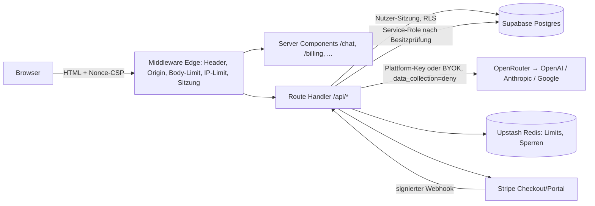

# Architektur

## Überblick

## Module (Code)

| Bereich | Datei |
|---|---|
| Kontext-Formatter (Perspektiven-Umkehr, Sliding Window, Token-Budget) | `lib/context-builder.ts` |
| Orchestrierung (Modi, Streaming, Buchung auch bei Abbruch, Tarifgrenzen, Summary) | `lib/orchestrator.ts`, `app/api/orchestrate/route.ts` |
| Router & Langzeitgedächtnis | `lib/router.ts` |
| Schlüsselwahl (BYOK / Plattform / Demo), OpenRouter | `lib/ai/provider.ts`, `lib/ai/demo-model.ts` |
| Kontingent, Rate-Limits, Sperren | `lib/usage-guard.ts`, `lib/rate-limit.ts` |
| Tarife | `lib/plans.ts`, `supabase/migrations/0003_billing.sql` |
| Datenzugriff | `lib/store/*` (Supabase mit RLS + Service-Role / In-Memory-Demo) |
| Sitzung, Konfiguration | `lib/session.ts`, `lib/env.ts`, `lib/supabase/*` |
| Sicherheit (Header, Origin, Krypto, Logs) | `middleware.ts`, `lib/security-headers.ts`, `lib/crypto.ts`, `lib/log.ts` |
| Auth-Routen | `app/api/auth/*`, `app/auth/callback/route.ts` |
| Konto / Billing | `app/api/account/*`, `app/api/billing/*`, `lib/billing.ts` |

## Ablauf einer Runde (`POST /api/orchestrate`)

1. Middleware: Origin, Größe, IP-Limit, Sitzung.
2. Route: Sitzung → Schema → Rundenlimit (IP + Konto, sonst 429) → Raum (RLS, sonst 404) → Hinweisfilter → Sperre (sonst 409).
3. Stream: Nutzer-Nachricht speichern → Sprecherplan nach Modus und Tarifgrenzen → je Turn: Modell-Allowlist, Prompt bauen (Budget 12k), Kontingent-Schätzung + Minutenlimit, streamen, Verbrauch buchen (auch bei Abbruch), Nachricht speichern → ggf. Summary (ab Pro) → `usage`, `done` → Sperre freigeben.

## Qualitätsziele

| Ziel | Wert |
|---|---|
| Erste Token-Ausgabe | abhängig vom Modell; UI zeigt sofort „denkt nach…“ |
| Max. Dauer einer Runde | 120 s (`maxDuration`) |
| Verfügbarkeit | Ziel 99,5 % (Vercel/Supabase) [ANNAHME A-013] |
| Barrierefreiheit | Tastatur, Fokus im Dialog, Beschriftungen; Prüfung TASK-020 |

## Konfiguration
Alle Variablen mit Einstufung: `docs/sicherheit.md` → „Schlüssel“; Vorlage `.env.example`. In Produktion startet die App nicht ohne Supabase, Service-Role-Key, Upstash und Betreiberangaben.
