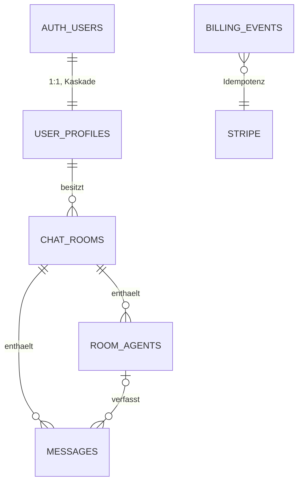

# Daten und Rechte

> Zusammengeführt aus Phase 11 (Daten) und Phase 12 (Rollen & Berechtigungen).

## Datenmodell

| Tabelle | Zweck | Besitzer | Wer schreibt | Löschung |
|---|---|---|---|---|
| `auth.users` | Konto (Supabase Auth) | Nutzer | Supabase Auth | Konto löschen (Admin-API) |
| `user_profiles` | Tarif, Limits, Verbrauch, BYOK (verschlüsselt), Stripe-IDs | Nutzer | nur Server (service_role) | Kaskade von `auth.users` |
| `chat_rooms` | Debatte, Einstellungen, Langzeitgedächtnis | Nutzer | Nutzer: Titel/Einstellungen; Server: Gedächtnis | Nutzer oder Kaskade |
| `room_agents` | Agenten-Konfiguration | Nutzer (über Raum) | Nutzer (RLS, Längen-CHECKs) | Nutzer oder Kaskade |
| `messages` | Verlauf + Token-Ledger | Nutzer (über Raum) | nur Server | Nutzer (Verlauf leeren) oder Kaskade |
| `billing_events` | verarbeitete Stripe-Events | Betreiber | nur Server | nach 90 Tagen [ANNAHME A-005] |
| View `user_usage_totals` | Summen für Dashboard | Nutzer | – (security_invoker) | – |

## Datenklassifizierung

| Objekt.Feld | Klasse | Begründung / Schutz |
|---|---|---|
| auth.users.email | personenbezogen | Login; nur Nutzer selbst und Server |
| user_profiles.custom_openrouter_key | geheim | AES-256-GCM, Spalte für Clients nicht lesbar, CHECK `v1:` |
| user_profiles.stripe_customer_id / subscription_id | personenbezogen (Vertrag) | für Clients nicht lesbar |
| user_profiles.tokens_used_this_month, subscription_tier | personenbezogen (Vertrag) | Clients nur lesen |
| messages.content, chat_rooms.running_summary, room_agents.system_prompt | personenbezogen, potenziell sensibel (Freitext) | nur Eigentümer; geht an KI-Anbieter (siehe unten); Hinweis „keine sensiblen Daten“ |
| Rate-Limit-Schlüssel (IP, Konto-ID, E-Mail-Hash) | personenbezogen (pseudonym) | Upstash, Ablauf ≤ 1 h |
| Sicherheitslog (Ereignis, Konto-ID/E-Mail-Hash, Zeit) | personenbezogen | ohne Inhalte, Aufbewahrung laut Hosting-Log-Retention [ANNAHME A-006] |

## Dateien
Keine Uploads, keine Dateispeicherung.

## Offline
Nicht vorgesehen (Web-App, Server-Streaming).

## Zeitfelder
`created_at` als `timestamptz` (UTC), Anzeige in Ortszeit des Browsers. `usage_period_start` = Monatsanfang UTC. Der Monatswechsel richtet sich nach UTC, nicht nach Ortszeit [ANNAHME A-007].

## Datenflüsse zu externen Diensten

| Dienst | Daten | Zweck | Region / Rechtsgrundlage Transfer |
|---|---|---|---|
| OpenRouter → OpenAI / Anthropic / Google u. a. | Ausschnitt Verlauf (Sliding Window, max. 12.000 Tokens), System-Prompts, Gedächtnis | Antworten erzeugen | USA [Q-003]; `data_collection: deny` |
| Supabase | alle App-Daten | Datenbank, Auth | Projektregion wählbar; EU empfohlen [ANNAHME A-008] |
| Upstash | IP, Konto-ID, E-Mail-Hash (Zähler) | Rate-Limits | Region wählbar; EU empfohlen |
| Stripe | E-Mail, Nutzer-ID, Zahlungsdaten (nur bei Stripe) | Zahlung | USA/EU [Q-004] |
| Vercel | Anfragen, IP in Logs | Hosting | USA/EU |

## Risikostufe

**Stufe 2** (bestätigt aus B1, E-002). Konten, normale personenbezogene Daten, Bezahlung nur über Stripe. Freitexte könnten besondere Daten (Art. 9 DSGVO) enthalten. Die App ist aber nicht dafür gedacht und weist ausdrücklich darauf hin. Würde sie gezielt für Gesundheits- oder Rechtsthemen vermarktet, wäre Stufe 3 nötig.

## Rollen & Berechtigungen

### Rollen

| Rolle | Wer | Zugriff auf fremde Daten? |
|---|---|---|
| Gast | nicht angemeldet | nein – nur Login, Registrierung, Reset, Impressum, Datenschutz |
| Nutzer | angemeldetes Konto | nein – nur eigene Räume, Agenten, Nachrichten, Profilwerte |
| Server | API-Routen mit Service-Role | ja, technisch – nur nach Prüfung der Nutzer-Sitzung bzw. Stripe-Signatur |
| Betreiber | Supabase-/Vercel-/Stripe-Dashboard | ja – nur für Support und Betrieb, 2FA Pflicht (E-003) |

Es gibt keine Admin-Rolle in der App selbst.

## Berechtigungsmatrix

| Ressource | Gast | Nutzer (eigene) | Nutzer (fremde) | Server |
|---|---|---|---|---|
| Raum lesen / anlegen / ändern (Titel, Einstellungen) / löschen | – | ✅ | ❌ 404 | ✅ |
| Raum-Gedächtnis (`running_summary`) schreiben | – | ❌ | ❌ | ✅ |
| Agent lesen / anlegen / ändern / löschen | – | ✅ (Tarifgrenzen, Modell-Allowlist) | ❌ 404 | ✅ |
| Nachricht lesen / Verlauf leeren | – | ✅ | ❌ 404 | ✅ |
| Nachricht schreiben (Ledger) | – | ❌ (nur über `/api/orchestrate`) | ❌ | ✅ |
| Profil lesen (Tarif, Verbrauch) | – | ✅ (ohne Key, ohne Stripe-IDs) | ❌ | ✅ |
| Tarif / Limits / Verbrauch ändern | – | ❌ | ❌ | ✅ (nur Webhook) |
| Eigenen API-Key setzen | – | ✅ (nur Workspace-Tarif, über API) | ❌ | ✅ |
| Export / Konto löschen | – | ✅ (frische Anmeldung ≤ 15 min) | ❌ | ✅ |

## Grundsätze
- Deny by default: RLS auf allen Tabellen; anon hat keinerlei Tabellenrechte.
- Besitz wird über die Kette `chat_rooms.user_id = auth.uid()` geprüft, nie über IDs aus der Anfrage.
- Fremde oder ungültige IDs antworten wie „nicht vorhanden“ (404, Zugriffs-Antwortstrategie).

## Teilen
Nicht vorgesehen.

## Pflicht-Testfälle (für Phase 19)

| Test | Erwartung | Bezug |
|---|---|---|
| T-SEC-13 | fremde/ungültige Agent-, Raum-IDs über API → 404 ohne Details | Matrix Zeilen 1–3 |
| T-SEC-16 | Nutzer A sieht über die Datenbank nur eigene Räume, Agenten, Nachrichten, Summen; anon nichts | RLS |
| T-SEC-17 | A kann fremde Räume, Agenten, Nachrichten weder ändern noch löschen | RLS |
| T-SEC-18 | A kann nichts in fremde Räume oder unter fremder `user_id` anlegen | RLS |
| T-SEC-19 | Ledger, Gedächtnis, Profil, Key: für Clients nicht schreibbar / Key nicht lesbar | Column-Grants |
| T-SEC-20 | Verbrauchs- und Tariffunktionen nur für service_role | Function-Grants |
